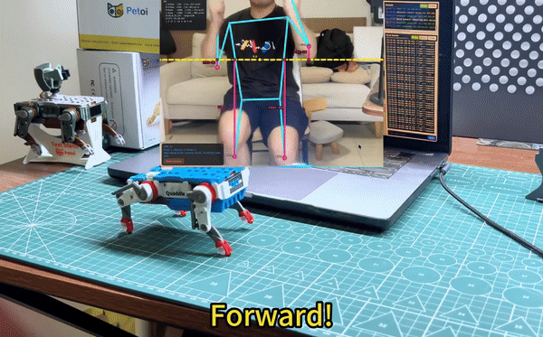
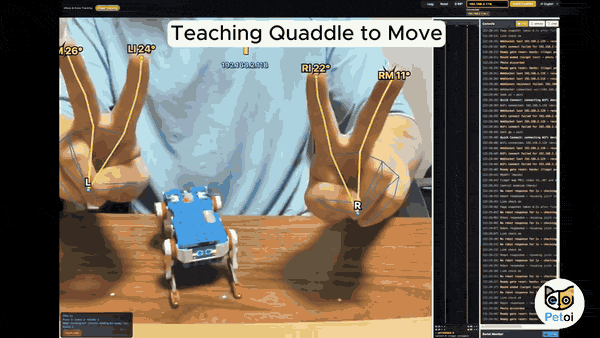

# CamWalkingGame: Control a Robot Dog With Your Body, Fingers or Face (Physical AI Demo)

**Webcam pose control for the Quaddle robot dog and OpenCat robots, running in your browser.** Your elbows and knees (or two fingers on each hand) drive the robot's four leg joints in real time, so you can make it walk, trot, bound and race. Connect by USB, Bluetooth or Wi-Fi. No robot code, no controller, no cloud: the computer vision runs on your own computer.

A hands-on physical AI demo for classrooms, makerspaces and exhibitions, by [Petoi](https://www.petoi.com/?utm_source=github&utm_medium=readme&utm_campaign=camwalkinggame).

[](https://www.youtube.com/watch?v=8U3mROh88vQ)

## Demo videos

| Video | What it shows |
|---|---|
| [Physical AI: Teach Robot Dog How to Walk, Race (Pose-Controlled Teleoperation)](https://www.youtube.com/watch?v=8U3mROh88vQ) | Body tracking: from wriggling to first steps, then gaits, racing and stunts. |
| [Finger-control Mini Robot Dog Quaddle](https://youtu.be/kbk8TnLfSDU) | Finger tracking: index fingers drive the front legs, middle fingers the back legs. |
| [Quaddle's First Field Test: Robot Dog Learning from Kids](https://youtu.be/JRcUbzh_atc?t=6) | Kids at the Silicon Valley Robotics Fair make Quaddle copy their moves, no instructions needed. |
| [Finger-Controlled Mini Robot Dog at Maker Faire Bay Area](https://youtube.com/shorts/2mOocKeKqsA?t=9) | A kid learns "magic fingers" at a crowded booth. |

## Three ways to control the robot

### 1. Elbow & Knee Tracking (full body)

Stand in front of the webcam. Your left and right elbows and knees map to the robot's four leg joints. The app reads each limb's 3D angle from the side (sagittal pitch), not its flat angle on the camera image. Moving your limbs in the right rhythm makes the robot walk, which turns gait coordination into something you feel, not a formula.

### 2. Finger Tracking

Built for crowded events, where several people in view confuse full-body tracking. Hold both hands up: index fingers drive the front legs, middle fingers the back legs, and each hand controls its own side. With the right timing and amplitude, Quaddle can walk, trot or bound.

[](https://youtu.be/kbk8TnLfSDU)

### 3. Body Follow

The robot reacts to where you are: its eyes follow you, it leans toward you, and with **Step** turned on it walks toward you as you approach and backs away as you retreat. Needs current robot firmware; the in-app Help has a pre-demo check.

## Quick start

1. Clone or [download](https://github.com/borntoleave/CamWalkingGame/archive/refs/heads/main.zip) this repository.
2. Run the launcher for your computer from the top-level folder:

| OS | Launch |
|----|--------|
| macOS | Double-click **`AutorunMac.command`** (uses built-in `python3`) |
| Windows | Double-click **`AutorunWin.bat`** (calls `scripts\AutorunWin.ps1`, **no Python**) |
| Linux | Run **`./AutorunLinux.sh`** (uses `python3`; opens Chrome/Edge/Chromium) |

3. Make sure the page opens in **Chrome** (Edge also works). Click **Open Camera** and allow camera access.
4. Connect your robot (next section), then follow the on-screen prompts to get ready.
5. Give the robot room so it can't walk off the table. A long rectangular box makes a good track.

Web files live under **`app/`** so you do not double-click `index.html` by mistake. Keep the server window open while demoing.

Windows opens `http://127.0.0.1:8080/` (IPv4) to avoid `localhost` → `::1` connection refused.

Manual equivalent (any OS with Python):

```bash
cd app
python3 -m http.server 8080 --bind 127.0.0.1
# open http://127.0.0.1:8080
```

If Safari shows *HTTPS-Only* / `WebKitErrorDomain:305`, switch to Chrome, or turn off Safari → Settings → Privacy → **HTTPS-Only Mode**.

## Connect your robot

| Method | How | Notes |
|---|---|---|
| USB (most reliable) | Plug a USB cable into the port on the back of Quaddle, then click **Connect** in the Serial Monitor (Web Serial, 115200) and pick the robot when Chrome asks for permission | Also used for setup: query the robot's IP, send Wi-Fi credentials, send manual commands. |
| Bluetooth | **Bluetooth** button; Chrome finds a nearby Petoi robot and asks for permission, no system pairing needed | Faster than Wi-Fi for live control. Disconnect it before switching to Wi-Fi. |
| Wi-Fi | First time: plug in USB and use **Connect WiFi** to send your network name and password (or **Query IP** if it's already on Wi-Fi). After that: **Connect IP**, no cable needed | Pose control over WebSocket. Previously used IPs reconnect automatically. |

## Troubleshooting

- **Finger Tracking won't get ready or stops responding:** cover the camera with your finger for about 2 seconds. Losing the hands restarts the ready step; then hold both hands up again.
- **Robot heads for the edge:** give it more room, or run it inside a long rectangular box. With **Step** on in Body Follow, put a barrier at the table edge first.

## Two players, two robots

Up to 2 people. One person controls every connected robot. With 2 people and 2 robots, the screen splits in two and each person controls their own robot.

## Privacy

Camera frames are processed in the page only. No image, landmark or face data is stored, logged or sent anywhere.

## Offline / exhibition

MediaPipe WASM + the pose model are vendored under `app/vendor/mediapipe/`, so the app works without internet.

The page **prefers the local** pose model. On the setup screen:

- **Update model** / **Use downloaded** — CDN download into the browser Cache API, or switch back without re-download
- **Use local** — bundled file (keeps any downloaded copy for later)

WASM / MediaPipe JS stay under `app/vendor/` (re-pack if you need to bump the package):

```bash
./scripts/download-mediapipe.sh
```

## How it works: physical AI in a browser

Webcam → [MediaPipe](https://ai.google.dev/edge/mediapipe) pose or hand landmarks (in the browser) → joint angles → OpenCat joint commands → the robot over USB, Bluetooth or Wi-Fi.

Physical AI is AI that perceives the real world and acts in it through a body. Here, an on-device computer vision model perceives your body or hands, and a real robot dog moves in response. You stay in control (pose-based teleoperation), so it's a gentle first step: students watch the perception side work live, and feel the control side, coordinating four joints into a gait, with their own bodies.

## FAQ

**Do I need to write code?** No. Open the page, connect the robot and move.

**Which robot does it work with?** It is built for [Quaddle](https://www.petoi.com/pages/quaddle-educational-robot-kit?utm_source=github&utm_medium=readme&utm_campaign=camwalkinggame), whose four leg joints match your two elbows and two knees. Bluetooth also finds other Petoi robots running [OpenCat](https://github.com/PetoiCamp/OpenCat).
<!-- [Kai: confirm Bittle X / Nybble Q support before claiming it here] -->

**Which browsers work?** Chrome or Edge (Web Serial and Web Bluetooth).

**Does it need internet?** No. The pose model and MediaPipe are bundled.

**Is this physical AI?** It's an entry-level physical AI demo: AI computer vision perceives a person, and a physical robot acts on it in real time. The robot doesn't plan on its own; you are the controller.

**Is this AI training the robot?** No. It is pose-based teleoperation: computer vision reads your body, and your movements drive the robot directly. That makes it a quick way to feel what multi-joint gaits take.

## Credits

Created by Rongzhong Li and Kai Mai at [Petoi](https://www.petoi.com/?utm_source=github&utm_medium=readme&utm_campaign=camwalkinggame). Prototyped with AI-assisted coding.

## License

[MIT](LICENSE) © 2026 Petoi LLC.

Third-party: MediaPipe Tasks Vision 0.10.18 and the bundled pose model under
`app/vendor/mediapipe/` are Apache-2.0, © Google LLC. Full text:
[`app/vendor/mediapipe/LICENSE`](app/vendor/mediapipe/LICENSE).
